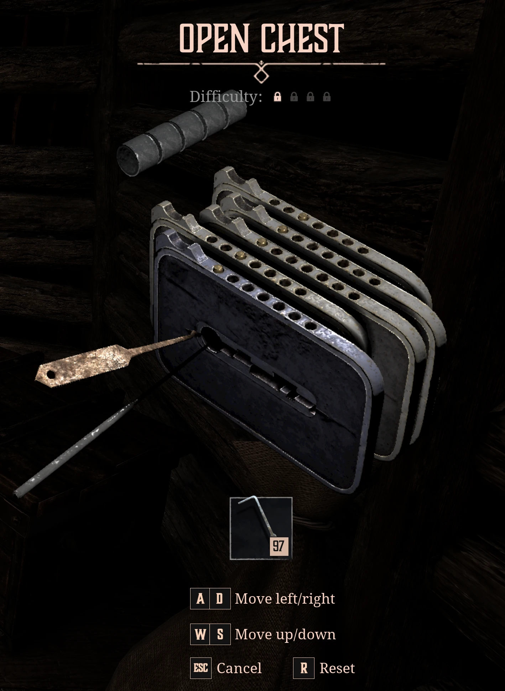

# g1r-lockpick

Solver for lock picking puzzles from [Gothic 1 Remake](https://en.wikipedia.org/wiki/Gothic_1_Remake).



Current algorithm minimizes the number of switches between the game and the solver. Within all possible
solutions with the same number of switches it finds one with minimal number of required key presses.

Solver guides you through the lock probing to deduce how plates are interconnected and then provides a
solution.

Solver requires only Python 3 and does not use any external libraries.

## Example lock picking session

Chest in Mud's hut in the Old Camp (on the screenshot above):

```text
$ ./g1r-lockpick.py 
Enter pin positions [1..7] from bottom left to top right
or Ctrl+D to exit
 > 13113

    5:         [ - - 3 - - - - ]     :5
    4:             [ 1 - - - - - - ] :4
    3:             [ 1 - - - - - - ] :3
    2:         [ - - 3 - - - - ]     :2
    1:             [ 1 - - - - - - ] :1 <- move left 1 time
                     |
                     |

Write plate shifts [<, ., >] from bottom left to top right
or `p <PLATE [1..5]> [<, ., >] ...` to set connections manually
or `s <STUCK PLATE [1..5]> ...` if stuck
or `b <STUCK PLATE [1..5]> ...` if lockpick broke
or `r` to continue from the initial state
or Ctrl+D to abandon this lock
 >> s3

          ---------------
    5 -- | ?  ?  ?  ?  > |
    4 -- | ?  ?  ?  >  ? |
    3 -- | ?  ?  >  ?  ? |
    2 -- | ?  >  ?  ?  ? |
    1 -- | >  ?  <  ?  ? |
    |     ---------------
    |      |  |  |  |  | 
    \      1  2  3  4  5 
     \                  \
      \                  affected
       moved by player

    5:         [ - - 3 - - - - ]     :5
    4:             [ 1 - - - - - - ] :4
    3:             [ 1 - - - - - - ] :3 <- move left 1 time
    2:         [ - - 3 - - - - ]     :2
    1:             [ 1 - - - - - - ] :1
                     |
                     |

Write plate shifts [<, ., >] from bottom left to top right
or `p <PLATE [1..5]> [<, ., >] ...` to set connections manually
or `s <STUCK PLATE [1..5]> ...` if stuck
or `b <STUCK PLATE [1..5]> ...` if lockpick broke
or `r` to continue from the initial state
or Ctrl+D to abandon this lock
 >> ..<..

          ---------------
    5 -- | ?  ?  ?  ?  > |
    4 -- | ?  ?  ?  >  ? |
    3 -- | .  .  >  .  . |
    2 -- | ?  >  ?  ?  ? |
    1 -- | >  ?  <  ?  ? |
    |     ---------------
    |      |  |  |  |  | 
    \      1  2  3  4  5 
     \                  \
      \                  affected
       moved by player

    5:         [ - - 3 - - - - ]     :5
    4:             [ 1 - - - - - - ] :4 <- move left 1 time
    3:           [ - 2 - - - - - ]   :3
    2:         [ - - 3 - - - - ]     :2
    1:             [ 1 - - - - - - ] :1
                     |
                     |

Write plate shifts [<, ., >] from bottom left to top right
or `p <PLATE [1..5]> [<, ., >] ...` to set connections manually
or `s <STUCK PLATE [1..5]> ...` if stuck
or `b <STUCK PLATE [1..5]> ...` if lockpick broke
or `r` to continue from the initial state
or Ctrl+D to abandon this lock
 >> ...<.

          ---------------
    5 -- | ?  ?  ?  ?  > |
    4 -- | .  .  .  >  . |
    3 -- | .  .  >  .  . |
    2 -- | ?  >  ?  ?  ? |
    1 -- | >  ?  <  ?  ? |
    |     ---------------
    |      |  |  |  |  | 
    \      1  2  3  4  5 
     \                  \
      \                  affected
       moved by player

    5:         [ - - 3 - - - - ]     :5
    4:           [ - 2 - - - - - ]   :4
    3:           [ - 2 - - - - - ]   :3
    2:         [ - - 3 - - - - ]     :2
    1:             [ 1 - - - - - - ] :1 <- move left 1 time
                     |
                     |

Write plate shifts [<, ., >] from bottom left to top right
or `p <PLATE [1..5]> [<, ., >] ...` to set connections manually
or `s <STUCK PLATE [1..5]> ...` if stuck
or `b <STUCK PLATE [1..5]> ...` if lockpick broke
or `r` to continue from the initial state
or Ctrl+D to abandon this lock
 >> <<>.>

          ---------------
    5 -- | ?  ?  ?  ?  > |
    4 -- | .  .  .  >  . |
    3 -- | .  .  >  .  . |
    2 -- | ?  >  ?  ?  ? |
    1 -- | >  >  <  .  < |
    |     ---------------
    |      |  |  |  |  | 
    \      1  2  3  4  5 
     \                  \
      \                  affected
       moved by player

    5:           [ - 2 - - - - - ]   :5 <- move left 1 time
    4:           [ - 2 - - - - - ]   :4
    3:             [ 1 - - - - - - ] :3
    2:       [ - - - 4 - - - ]       :2
    1:           [ - 2 - - - - - ]   :1
                     |
                     |

Write plate shifts [<, ., >] from bottom left to top right
or `p <PLATE [1..5]> [<, ., >] ...` to set connections manually
or `s <STUCK PLATE [1..5]> ...` if stuck
or `b <STUCK PLATE [1..5]> ...` if lockpick broke
or `r` to continue from the initial state
or Ctrl+D to abandon this lock
 >> ..<><

          ---------------
    5 -- | .  .  >  <  > |
    4 -- | .  .  .  >  . |
    3 -- | .  .  >  .  . |
    2 -- | ?  >  ?  ?  ? |
    1 -- | >  >  <  .  < |
    |     ---------------
    |      |  |  |  |  | 
    \      1  2  3  4  5 
     \                  \
      \                  affected
       moved by player

    5:         [ - - 3 - - - - ]     :5
    4:             [ 1 - - - - - - ] :4
    3:           [ - 2 - - - - - ]   :3
    2:       [ - - - 4 - - - ]       :2 -> move right 1 time
    1:           [ - 2 - - - - - ]   :1
                     |
                     |

Write plate shifts [<, ., >] from bottom left to top right
or `p <PLATE [1..5]> [<, ., >] ...` to set connections manually
or `s <STUCK PLATE [1..5]> ...` if stuck
or `b <STUCK PLATE [1..5]> ...` if lockpick broke
or `r` to continue from the initial state
or Ctrl+D to abandon this lock
 >> .>.<.

          ---------------
    5 -- | .  .  >  <  > |
    4 -- | .  .  .  >  . |
    3 -- | .  .  >  .  . |
    2 -- | .  >  .  <  . |
    1 -- | >  >  <  .  < |
    |     ---------------
    |      |  |  |  |  | 
    \      1  2  3  4  5 
     \                  \
      \                  affected
       moved by player

Current lock state:

    5:         [ - - 3 - - - - ]     :5
    4:           [ - 2 - - - - - ]   :4
    3:           [ - 2 - - - - - ]   :3
    2:         [ - - 3 - - - - ]     :2
    1:           [ - 2 - - - - - ]   :1
                     |
                     |

Solving...

!!!!!!!!!!!!!!!!!!!!!!!!!!!!!!!!!!!!!!!!!!!!!!!!!!!!!!!!!!!!!!!!
!                                                              !
!               Time passed: 0.093s (93450514ns)               !
!               Solution requires 18 key presses               !
!                                                              !
!!!!!!!!!!!!!!!!!!!!!!!!!!!!!!!!!!!!!!!!!!!!!!!!!!!!!!!!!!!!!!!!

    5:         [ - - 3 - - - - ]     :5
    4:           [ - 2 - - - - - ]   :4
    3:           [ - 2 - - - - - ]   :3
    2:         [ - - 3 - - - - ]     :2 -> move right 1 time
    1:           [ - 2 - - - - - ]   :1
                     |
                     |

Press Enter after applying step 1/5
or write `r` to restart from the initial state
or Ctrl+D to abandon this lock
 >> 

    5:         [ - - 3 - - - - ]     :5
    4:         [ - - 3 - - - - ]     :4
    3:           [ - 2 - - - - - ]   :3 <- move left 1 time
    2:           [ - 2 - - - - - ]   :2
    1:           [ - 2 - - - - - ]   :1
                     |
                     |

Press Enter after applying step 2/5
or write `r` to restart from the initial state
or Ctrl+D to abandon this lock
 >> 

    5:         [ - - 3 - - - - ]     :5
    4:         [ - - 3 - - - - ]     :4 <- move left 4 times
    3:         [ - - 3 - - - - ]     :3
    2:           [ - 2 - - - - - ]   :2
    1:           [ - 2 - - - - - ]   :1
                     |
                     |

Press Enter after applying step 3/5
or write `r` to restart from the initial state
or Ctrl+D to abandon this lock
 >> 

    5:         [ - - 3 - - - - ]     :5 <- move left 3 times
    4: [ - - - - - - 7 ]             :4
    3:         [ - - 3 - - - - ]     :3
    2:           [ - 2 - - - - - ]   :2
    1:           [ - 2 - - - - - ]   :1
                     |
                     |

Press Enter after applying step 4/5
or write `r` to restart from the initial state
or Ctrl+D to abandon this lock
 >> 

    5:   [ - - - - - 6 - ]           :5
    4:       [ - - - 4 - - - ]       :4
    3:   [ - - - - - 6 - ]           :3
    2:           [ - 2 - - - - - ]   :2
    1:           [ - 2 - - - - - ]   :1 <- move left 2 times
                     |
                     |

Press Enter after applying step 5/5
or write `r` to restart from the initial state
or Ctrl+D to abandon this lock
 >> 

!!!!!!!!!!!!!!!!!!!!!!!!!!!!!!!!!!!!!!!!!!!!!!!!!!!!!!!!!!!!!!!!
!                                                              !
!               Should be solved after 5 steps!                !
!                                                              !
!!!!!!!!!!!!!!!!!!!!!!!!!!!!!!!!!!!!!!!!!!!!!!!!!!!!!!!!!!!!!!!!
```
